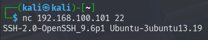
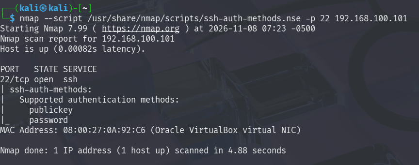
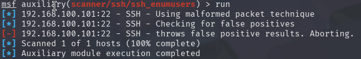
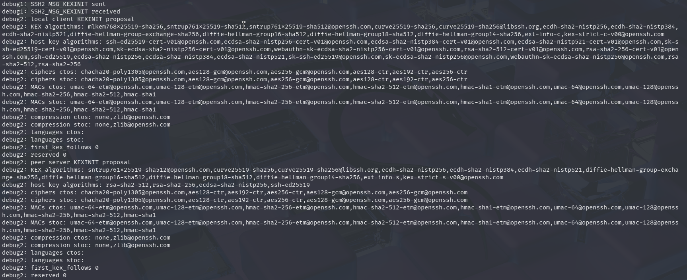
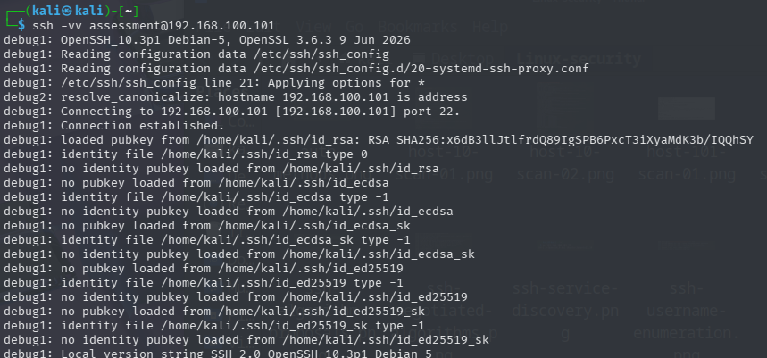

# Findings Analysis

## 1. Introduction

This document evaluates observations obtained during the black-box security assessment of the target system.

The analysis is based on evidence collected remotely from Kali Linux. Its purpose is to determine whether the observed behaviour of exposed services indicates a security weakness that can be substantiated through assessment evidence.

The analysis distinguishes between:

- Confirmed security findings.
- Potential security concerns requiring further investigation.
- Informational observations that do not independently establish a vulnerability.
- Inconclusive assessment activities.

Only evidence-supported weaknesses will be classified as confirmed security findings.

This document currently covers the SSH service assessment. The analysis of other exposed services will be added as the assessment progresses.

## 2. SSH Service Analysis

### 2.1 Service Identification

The SSH service on `192.168.100.101` identified itself through its service banner as:

`SSH-2.0-OpenSSH_9.6p1 Ubuntu-3ubuntu13.19`

The version was also identified through Metasploit service fingerprinting.

**Evidence — SSH service banner:**

**Evidence — Metasploit SSH version scan:**

.png)

**Analysis:**

The banner identifies the SSH implementation and its reported version.

However, version identification alone does not establish that the service contains a known vulnerability. Ubuntu may incorporate security patches into its packages without changing the upstream OpenSSH version displayed in the banner.

Therefore, vulnerability status cannot be determined solely from the reported version.

**Disposition:** Informational observation. No vulnerability established.

### 2.2 Authentication Methods

Remote authentication-method enumeration identified the following methods:

- `publickey`
- `password`

**Evidence — SSH authentication methods:**

**Analysis:**

The SSH service advertises both public-key and password authentication.

Password authentication can introduce additional security risks when weak credentials, inadequate authentication protections or excessive exposure are present.

However, the advertisement of password authentication does not establish that any account has a weak password, that authentication controls are inadequate, or that unauthorized access is possible.

The collected evidence establishes which authentication methods the service advertises. It does not establish whether valid credentials can be obtained, whether authentication controls can be bypassed, or whether unauthorized access is possible.

**Disposition:** Potential hardening observation. Insufficient evidence to classify as a vulnerability.

### 2.3 Username Enumeration

The Metasploit SSH username enumeration module was used to investigate whether the service disclosed valid usernames through its responses.

The module reported that the target produced false-positive results and aborted execution after its validation procedure.

**Evidence — SSH username enumeration attempt:**

**Analysis:**

The module did not produce reliable username enumeration results.

Consequently, the assessment did not establish whether valid usernames could be distinguished from invalid usernames through the tested technique.

The result must therefore be treated as inconclusive. It cannot be used to claim that username disclosure exists or that username enumeration has been successfully prevented.

No verified usernames were obtained through this test.

**Disposition:** Inconclusive test. No username disclosure finding established.

### 2.4 Cryptographic Algorithm Proposals

The server's SSH algorithm proposals were examined using verbose SSH negotiation output.

The server advertised multiple categories of cryptographic algorithms, including:

- Key exchange algorithms.
- Host key algorithms.
- Encryption algorithms.
- Message authentication algorithms.
- Compression algorithms.

The advertised MAC algorithms included SHA-2-based and SHA-1-based options.

**Evidence — SSH algorithm proposals:**

**Additional evidence — SSH verbose negotiation:**

**Raw evidence:** [SSH verbose negotiation output](evidence/ssh-verbose-negotiation.txt)

**Analysis:**

The presence of multiple algorithm options demonstrates that the server supports different cryptographic choices for SSH connections.

Of particular interest, the server advertised the following SHA-1-based MAC algorithms:

- `hmac-sha1-etm@openssh.com`
- `hmac-sha1`

Their availability raises a cryptographic configuration and compatibility consideration.

However, the presence of these algorithms in the server's proposals does not establish that they were used to protect the observed session or that an attacker could exploit their availability.

It is also important to distinguish HMAC-SHA1 from SHA-1 digital signatures. They are different cryptographic constructions, and weaknesses associated with SHA-1 collision attacks against digital signatures cannot automatically be applied to HMAC-SHA1.

The actual negotiated algorithms must therefore be considered separately.

**Disposition:** Potential cryptographic hardening observation. No demonstrated cryptographic vulnerability.

