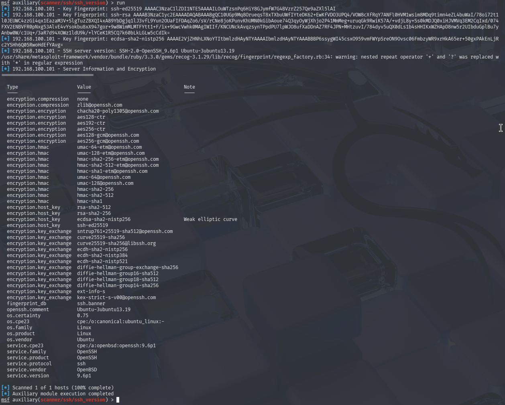
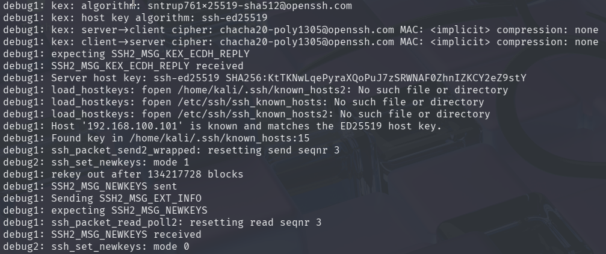

# Findings Analysis

## 1. Introduction

This document evaluates observations obtained during the black-box security assessment of the target system.

The analysis is based on evidence collected remotely from Kali Linux. Its purpose is to determine whether the observed behaviour of exposed services indicates a security weakness that can be substantiated through assessment evidence.

The analysis distinguishes between:

- Confirmed security findings.
- Potential security concerns requiring further investigation.
- Informational observations that do not independently establish a vulnerability.
- Inconclusive assessment activities.

Only evidence-supported weaknesses will be classified as confirmed security findings.

This document currently covers the SSH service assessment. The analysis of other exposed services will be added as the assessment progresses.

## 2. SSH Service Analysis

### 2.1 Service Identification

The SSH service on `192.168.100.101` identified itself through its service banner as:

`SSH-2.0-OpenSSH_9.6p1 Ubuntu-3ubuntu13.19`

The version was also identified through Metasploit service fingerprinting.

**Evidence — SSH service banner:**

**Evidence — Metasploit SSH version scan:**

**Analysis:**

The banner identifies the SSH implementation and its reported version.

However, version identification alone does not establish that the service contains a known vulnerability. Ubuntu may incorporate security patches into its packages without changing the upstream OpenSSH version displayed in the banner.

Therefore, vulnerability status cannot be determined solely from the reported version.

**Disposition:** Informational observation. No vulnerability established.

### 2.2 Authentication Methods

Remote authentication-method enumeration identified the following methods:

- `publickey`
- `password`

**Evidence — SSH authentication methods:**

**Analysis:**

The SSH service advertises both public-key and password authentication.

Password authentication can introduce additional security risks when weak credentials, inadequate authentication protections or excessive exposure are present.

However, the advertisement of password authentication does not establish that any account has a weak password, that authentication controls are inadequate, or that unauthorized access is possible.

The collected evidence establishes which authentication methods the service advertises. It does not establish whether valid credentials can be obtained, whether authentication controls can be bypassed, or whether unauthorized access is possible.

**Disposition:** Potential hardening observation. Insufficient evidence to classify as a vulnerability.

### 2.3 Username Enumeration

The Metasploit SSH username enumeration module was used to investigate whether the service disclosed valid usernames through its responses.

The module reported that the target produced false-positive results and aborted execution after its validation procedure.

**Evidence — SSH username enumeration attempt:**

**Analysis:**

The module did not produce reliable username enumeration results.

Consequently, the assessment did not establish whether valid usernames could be distinguished from invalid usernames through the tested technique.

The result must therefore be treated as inconclusive. It cannot be used to claim that username disclosure exists or that username enumeration has been successfully prevented.

No verified usernames were obtained through this test.

**Disposition:** Inconclusive test. No username disclosure finding established.

### 2.4 Cryptographic Algorithm Proposals

The server's SSH algorithm proposals were examined using verbose SSH negotiation output.

The server advertised multiple categories of cryptographic algorithms, including:

- Key exchange algorithms.
- Host key algorithms.
- Encryption algorithms.
- Message authentication algorithms.
- Compression algorithms.

The advertised MAC algorithms included SHA-2-based and SHA-1-based options.

**Evidence — SSH algorithm proposals:**

**Additional evidence — SSH verbose negotiation:**

**Raw evidence:** [SSH verbose negotiation output](evidence/ssh-verbose-negotiation.txt)

**Analysis:**

The presence of multiple algorithm options demonstrates that the server supports different cryptographic choices for SSH connections.

Of particular interest, the server advertised the following SHA-1-based MAC algorithms:

- `hmac-sha1-etm@openssh.com`
- `hmac-sha1`

Their availability raises a cryptographic configuration and compatibility consideration.

However, the presence of these algorithms in the server's proposals does not establish that they were used to protect the observed session or that an attacker could exploit their availability.

It is also important to distinguish HMAC-SHA1 from SHA-1 digital signatures. They are different cryptographic constructions, and weaknesses associated with SHA-1 collision attacks against digital signatures cannot automatically be applied to HMAC-SHA1.

The actual negotiated algorithms must therefore be considered separately.

**Disposition:** Potential cryptographic hardening observation. No demonstrated cryptographic vulnerability.

### 2.5 Negotiated Cryptographic Algorithms

The verbose SSH connection output identified the algorithms selected during the observed connection.

The negotiated algorithms were:

| Component | Negotiated algorithm |
|---|---|
| Key exchange | `sntrup761x25519-sha512@openssh.com` |
| Host key | `ssh-ed25519` |
| Server-to-client cipher | `chacha20-poly1305@openssh.com` |
| Client-to-server cipher | `chacha20-poly1305@openssh.com` |
| MAC | Implicit |
| Compression | `none` |

**Evidence — Negotiated algorithms:**

**Raw evidence:** [SSH verbose negotiation output](evidence/ssh-verbose-negotiation.txt)

**Analysis:**

The observed connection negotiated a hybrid key exchange combining the post-quantum-resistant SNTRUP761 component with X25519.

The server also presented an Ed25519 host key, while ChaCha20-Poly1305 was selected for encryption in both communication directions.

ChaCha20-Poly1305 is an authenticated encryption with associated data (AEAD) cipher. Its authentication tag is integrated into the cipher operation. This explains why the verbose output reports the MAC as implicit rather than identifying a separate MAC algorithm.

The connection also negotiated no compression.

These results indicate that the observed SSH session used modern cryptographic mechanisms.

However, the results represent one observed connection. They do not establish that every algorithm advertised by the server is equally appropriate or that all possible client connections would negotiate the same algorithms.

**Disposition:** No cryptographic weakness demonstrated in the observed negotiation.

### 2.6 ECDSA P-256 Scanner Annotation

The Metasploit SSH version scanner identified `ecdsa-sha2-nistp256` and labelled it as a weak elliptic curve.

**Evidence — Metasploit SSH version scan:**

**Analysis:**

The scanner's annotation is not sufficient evidence to classify the algorithm as vulnerable.

The NIST P-256 curve is a recognised elliptic curve used in established cryptographic systems. Its presence alone does not demonstrate an exploitable weakness.

No independent evidence was collected demonstrating that the advertised ECDSA P-256 option could be exploited or that it compromised the observed SSH connection.

The scanner annotation should therefore not be accepted as a confirmed vulnerability without further technical justification.

**Disposition:** Unverified scanner annotation. Not classified as a finding.

### 2.7 SSH Host Key Verification

During the verbose SSH connection, the server presented an Ed25519 host key with the fingerprint:

`SHA256:KtTKNwLqePyraXQoPuJ7zSRWNAF0ZhnIZKCY2eZ9stY`

The client reported that the host key matched the previously recorded key in its `known_hosts` file.

**Evidence — SSH negotiated algorithms and host key verification:**

**Raw evidence:** [SSH verbose negotiation output](evidence/ssh-verbose-negotiation.txt)

**Analysis:**

The output demonstrates consistency between the host key presented during the observed connection and the key previously recorded by the Kali client.

This supports continuity with the previously recorded host key. It does not independently establish the identity of the remote system.

Additionally, the successful key exchange and exchange of `NEWKEYS` messages demonstrate that the SSH transport negotiation progressed to the point where the negotiated keys were activated.

This does not establish successful user authentication.

**Disposition:** Informational observation. No security weakness established.

## 3. Consolidated SSH Analysis

The following table summarises the results of the SSH assessment.

| Observation | Assessment outcome | Classification |
|---|---|---|
| OpenSSH version identified | Version identified; vulnerability not established | Informational |
| Password authentication advertised | Additional authentication exposure to consider | Potential hardening observation |
| Public-key authentication advertised | Authentication method identified | Informational |
| Username enumeration attempt | Tool aborted due to unreliable results | Inconclusive |
| SHA-1-based MAC algorithms advertised | Cryptographic configuration concern requiring consideration | Potential hardening observation |
| Modern algorithms negotiated | No weakness demonstrated in the observed session | Informational |
| ECDSA P-256 scanner warning | Not independently substantiated | Unverified observation |
| Host key consistency | Previously recorded key matched | Informational |

## 4. SSH Findings Decision

Based on the evidence collected, the SSH assessment has not established a confirmed vulnerability.

Two areas remain relevant for security consideration:

1. Password authentication is advertised by the service.
2. SHA-1-based MAC algorithms are included among the server's advertised options.

Neither observation independently demonstrates an exploitable weakness.

The username enumeration attempt was inconclusive, while the observed SSH connection negotiated modern cryptographic algorithms.

**Current decision: No confirmed reportable SSH vulnerability identified from the evidence collected.**

This conclusion is limited to the tests performed. It does not establish that the SSH service is free from vulnerabilities or that its complete security configuration is optimal.

## 5. Assessment Limitations

The conclusions above are subject to the following limitations:

- The assessment examined the SSH service remotely from Kali Linux.
- The SSH version banner was not independently sufficient to establish vulnerability status.
- The username enumeration technique did not produce reliable results.
- The assessment did not demonstrate successful unauthorized authentication.
- The advertised cryptographic algorithms were not all individually tested for exploitability.
- The negotiated algorithms represent the observed connection and may not represent every possible client connection.
- The assessment did not establish whether password authentication is protected by adequate account and authentication controls.
- No conclusion is made about security controls that were not observable through the tests performed.

## 6. Conclusion

The SSH assessment provided information about the service's reported implementation, authentication methods, cryptographic capabilities and actual algorithm negotiation.

Although some advertised options warrant consideration from a hardening perspective, the available evidence does not establish a confirmed SSH vulnerability.

The SSH findings analysis is therefore provisionally closed with no confirmed reportable vulnerability.

The overall target assessment remains open. Other exposed services identified during reconnaissance must still be considered before the security assessment can be concluded.
