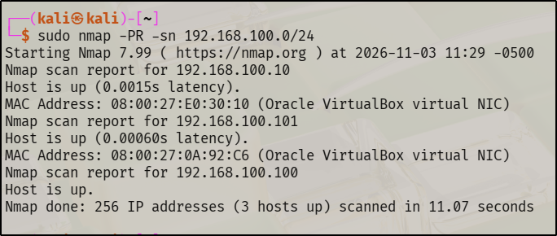
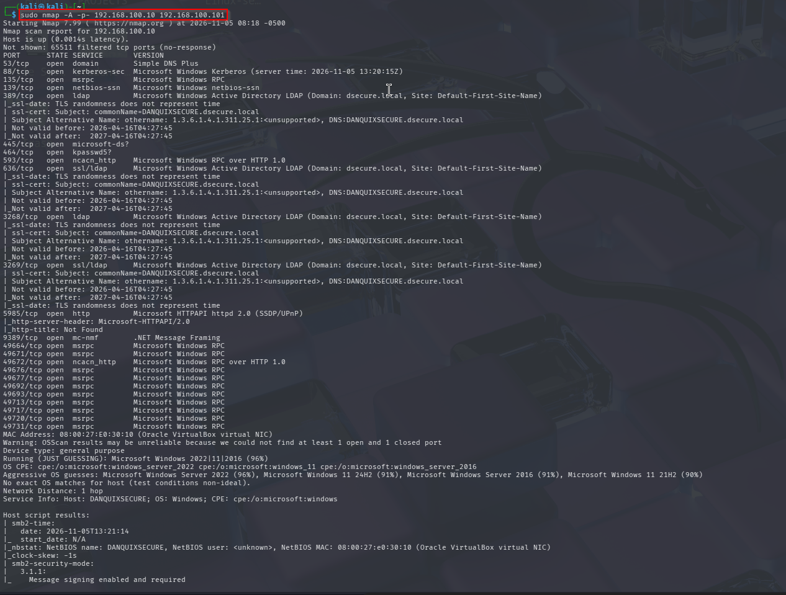
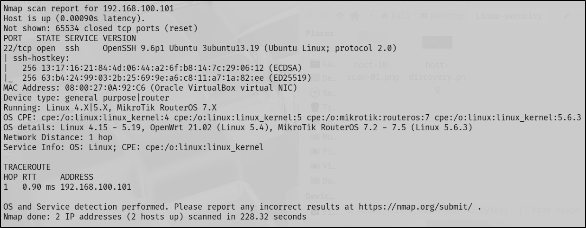
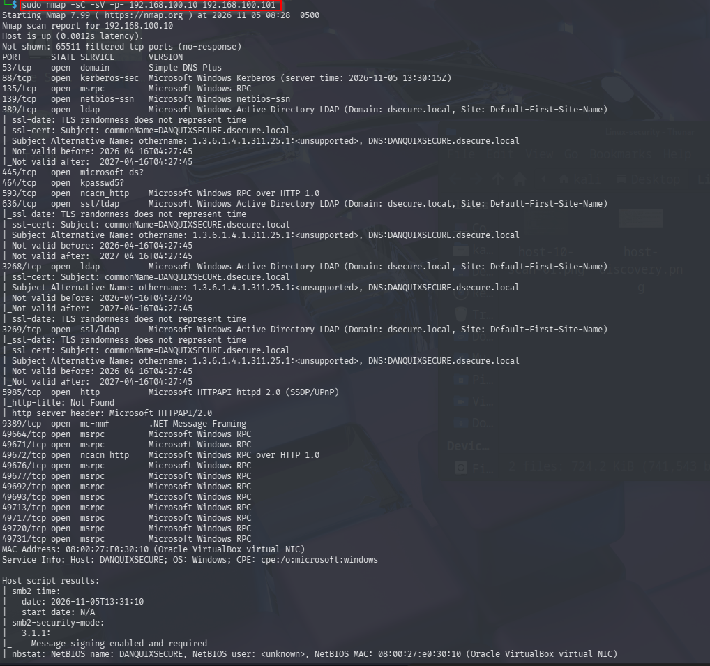
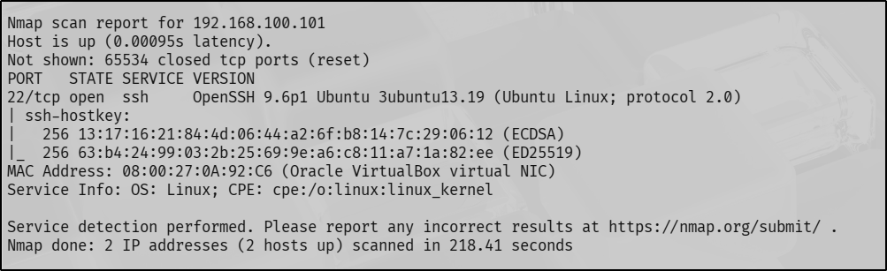

# Initial Reconnaissance: Host Discovery, Host Profiling, and Target Identification

## 1. Introduction

This document records the network reconnaissance activities conducted against the authorized virtual laboratory environment.

The assessment begins from the perspective of a security tester who has access to the authorized network scope but does not rely on previously collected system configuration information to identify the target.

The purpose of this phase is to investigate the network, identify active hosts, examine their exposed services, and collect sufficient evidence to establish the identity of the intended assessment target.

All observations and conclusions documented here are based on evidence collected during the assessment.

## 2. Assessment Scope

The assessment is restricted to the authorized virtual laboratory network.

| Item | Details |
|---|---|
| Assessment network | `192.168.100.0/24` |
| Assessment machine | Kali Linux |
| Assessment interface | `eth1` |
| Assessment machine IP | `192.168.100.100` |
| Assessment approach | Network reconnaissance |
| Environment | VirtualBox laboratory |

The network range defines the authorized boundary for the reconnaissance activity.

The target's identity and address are to be established through the assessment process rather than assumed from previously collected baseline information.

## 3. Host Discovery

### 3.1 Objective

Identify active hosts within the authorized assessment network.

The initial investigation focuses on host availability without performing TCP port scanning.

### 3.2 Methodology

The Kali assessment machine was connected to the same local network segment as the systems within the laboratory.

ARP-based host discovery was selected because it is suitable for identifying active systems on a directly connected local network. ARP discovery identifies responding devices on the local network. It does not establish that those devices are necessarily the intended assessment targets.

The following Nmap command was executed:

```bash
sudo nmap -PR -sn 192.168.100.0/24
```

**Command breakdown:**

- `sudo`: Executes Nmap with elevated privileges.
- `nmap`: Network discovery and security auditing tool.
- `-PR`: Uses ARP requests for host discovery.
- `-sn`: Disables port scanning and performs host discovery only.
- `192.168.100.0/24`: Specifies the authorized assessment network.

### 3.3 Evidence



**Evidence description:** Terminal output showing the results of ARP-based host discovery across the authorized network.

### 3.4 Observations

The scan identified three active hosts:

| IP Address | MAC Address | Observation |
|---|---|---|
| `192.168.100.100` | Not displayed | Kali assessment machine |
| `192.168.100.10` | `08:00:27:E0:30:10` | Active host |
| `192.168.100.101` | `08:00:27:0A:92:C6` | Active host |

The MAC address vendor information associated with the two additional hosts indicated Oracle VirtualBox virtual network interfaces.

The Kali assessment machine was excluded from the candidate target list because it was the system performing the scan.

### 3.5 Evaluation

The discovery activity established the presence of two additional active hosts within the authorized network.

However, the results did not provide sufficient information to establish the operating systems, roles, or exposed services of those hosts.

Further investigation was therefore required.

## 4. Host Profiling and Service Enumeration

### 4.1 Objective

Investigate the discovered hosts to collect information about their exposed TCP ports, accessible services, service versions, and operating-system indicators.

At this stage, the identity and role of each host remain undetermined.

The investigation will use the responses returned by the hosts to develop an evidence-based understanding of the systems.

### 4.2 Initial Comprehensive Scan

An initial comprehensive scan was performed against the two candidate hosts to investigate their exposed TCP ports, services, and other available system identification information.

The following command was executed:

```bash
sudo nmap -A -p- 192.168.100.10 192.168.100.101
```

**Command breakdown:**

- `-A`: Enables operating-system detection, version detection, default NSE scripts, and traceroute.
- `-p-`: Scans all 65,535 TCP ports.

#### Evidence

**Host: 192.168.100.10**



**Host: 192.168.100.101**



### 4.3 Additional Service Enumeration

A second scan was conducted against the same hosts to obtain service identification and version information.

The following command was executed:

```bash
sudo nmap -sC -sV -p- 192.168.100.10 192.168.100.101
```

**Command breakdown:**

- `-sC`: Executes Nmap's default NSE scripts.
- `-sV`: Performs service and version detection.
- `-p-`: Scans all 65,535 TCP ports.

Unlike the initial comprehensive scan, this command does not enable operating-system detection or traceroute.

#### Evidence

**Host: 192.168.100.10**



**Host: 192.168.100.101**



### 4.4 Observations and Evaluation

The results from both scans were examined to establish the characteristics of each candidate host.

#### 4.4.1 Host: 192.168.100.10

**Observations**

The scans identified:

- 24 open TCP ports.
- 65,511 filtered TCP ports.
- Multiple services associated with Microsoft Windows infrastructure.

Notable services included:

| Port | Service | Observation |
|---|---|---|
| `53/tcp` | DNS | Simple DNS Plus |
| `88/tcp` | Kerberos | Microsoft Windows Kerberos |
| `135/tcp` | MSRPC | Microsoft RPC |
| `139/tcp` | NetBIOS | NetBIOS session service |
| `389/tcp` | LDAP | Microsoft Active Directory LDAP |
| `445/tcp` | SMB | Microsoft SMB |
| `464/tcp` | kpasswd5 | Kerberos password change |
| `636/tcp` | LDAPS | LDAP over TLS |
| `3268/tcp` | Global Catalog | Active Directory Global Catalog |
| `3269/tcp` | Global Catalog SSL | Secure Global Catalog |
| `5985/tcp` | HTTP | Microsoft HTTPAPI |
| `9389/tcp` | .NET Message Framing | Active Directory Web Services |

Additional high-numbered ports associated with Microsoft RPC services were also identified.

The scans returned the following identification information:

- Hostname: `DANQUIXSECURE`
- Domain: `dsecure.local`
- LDAP identification: Microsoft Active Directory

Nmap suggested Windows Server 2022 as an operating-system match with a 96% confidence estimate. Other Windows versions were also returned as alternative matches.

However, Nmap reported that it could not obtain the required combination of open and closed ports for reliable OS fingerprinting. Consequently, the operating-system identification should be treated as an estimate rather than a confirmed result.

**Evaluation**

The combination of DNS, Kerberos, LDAP, SMB, and Active Directory-related services provides strong evidence that this host performs a Windows domain infrastructure role.

The hostname and domain information provide additional support for this interpretation.

However, the exact operating-system version was not conclusively established.

#### 4.4.2 Host: 192.168.100.101

**Observations**

The scans identified one open TCP port:

| Port | Service | Version |
|---|---|---|
| `22/tcp` | SSH | OpenSSH 9.6p1 Ubuntu 3ubuntu13.19 |

The remaining TCP ports were reported as closed.

The SSH service returned an Ubuntu-packaged OpenSSH version.

Nmap's operating-system fingerprinting produced possible Linux and MikroTik RouterOS matches. These results were ambiguous and did not independently establish the exact operating system.

**Evaluation**

The Ubuntu-specific SSH service banner provides a strong indication that the host is running an Ubuntu-based system.

However, a service banner alone is not definitive proof of the underlying operating system because service identification information can be modified or misleading.

Additional investigation would be required to corroborate the operating-system identity.

## 5. Target Identification

### 5.1 Evaluation of Candidate Hosts

The evidence collected during host profiling established the following distinctions:

| IP Address | Evidence collected | Evaluation |
|---|---|---|
| `192.168.100.10` | DNS, Kerberos, LDAP, SMB, Active Directory-related services, hostname and domain information | Strong evidence of a Windows domain infrastructure role |
| `192.168.100.101` | OpenSSH 9.6p1 Ubuntu service banner on TCP port 22 | Strong indication of an Ubuntu-based system |

### 5.2 Target Selection

The project assessment focuses on the security of an Ubuntu Linux server.

The SSH service identification on `192.168.100.101` provides evidence consistent with this assessment objective.

Based on this evidence, `192.168.100.101` was selected as the provisional assessment target.

This selection was made using independently collected reconnaissance evidence rather than relying on the target IP address recorded in the system baseline.

The identification remains provisional until further assessment provides additional corroboration.

**Selected assessment target:** `192.168.100.101`

## 6. Assessment Limitations

The reconnaissance activity established the presence of active hosts and identified their exposed TCP services.

The following limitations apply to the results:

1. **Operating-system identification:** Nmap's operating-system fingerprinting did not conclusively establish the exact operating-system versions.

2. **Service banner reliability:** Service banners provide useful identification information but may be modified or misleading.

3. **Port exposure:** An open port indicates an accessible network service. It does not automatically establish the presence of a security vulnerability.

4. **Vulnerability confirmation:** No security vulnerability was confirmed during this reconnaissance activity.

5. **Access and exploitation testing:** No authentication testing, exploitation, or access-control verification was performed during this reconnaissance activity.

6. **Assessment depth:** The current investigation focused on host discovery and TCP service identification. Other areas of system security have not yet been assessed.

## 7. Reconnaissance Summary

The reconnaissance activity produced the following results:

| Activity | Result |
|---|---|
| Authorized network investigation | Completed |
| Active host discovery | Three active hosts identified |
| Assessment machine identification | Identified and excluded from candidate targets |
| Candidate host profiling | Two additional hosts examined |
| Service identification | Exposed TCP services identified |
| Target selection | `192.168.100.101` selected provisionally |
| Vulnerability confirmation | Not established during reconnaissance |

The results provide an initial understanding of the network environment and establish a basis for further investigation of the selected target.

## 8. Next Assessment Activity

The next activity will investigate the SSH service identified on `192.168.100.101`.

The investigation will examine its remotely observable characteristics and identify information relevant to evaluating the service's security posture.

Any potential security weaknesses must be supported by collected evidence before they are classified as findings.

