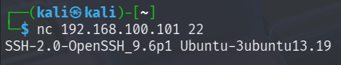
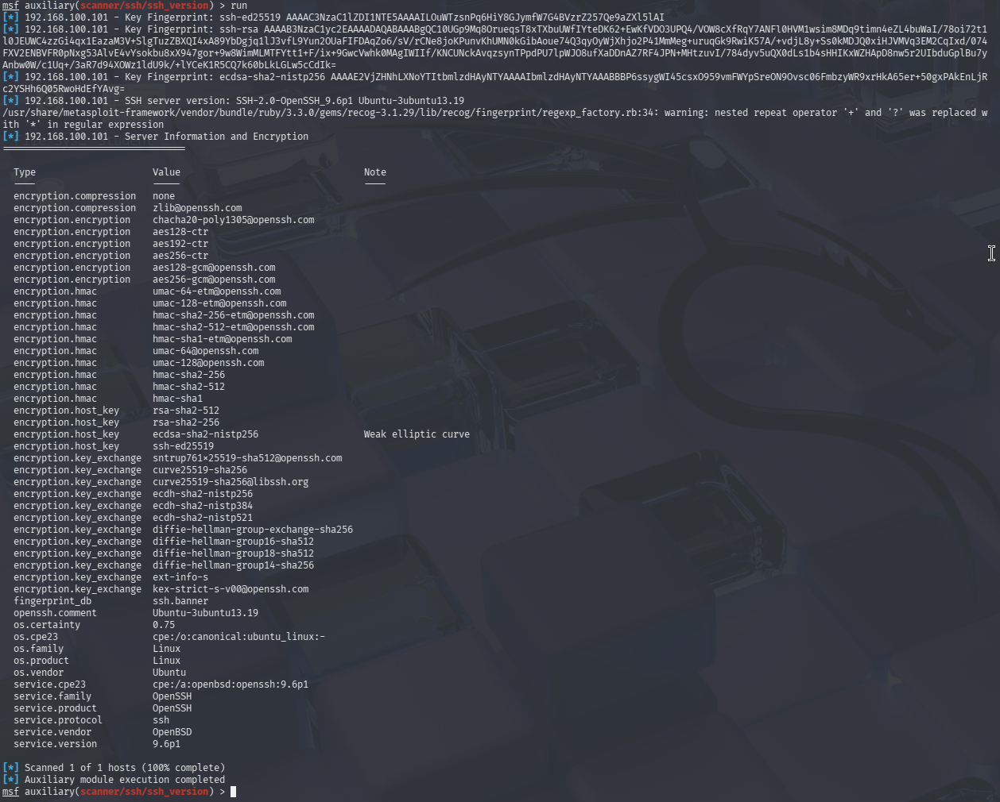
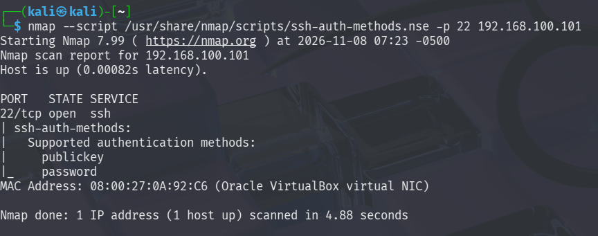
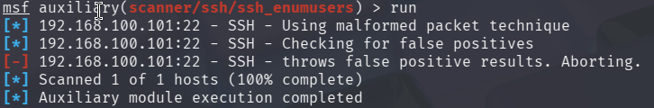
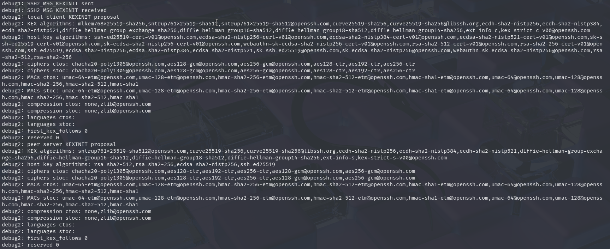
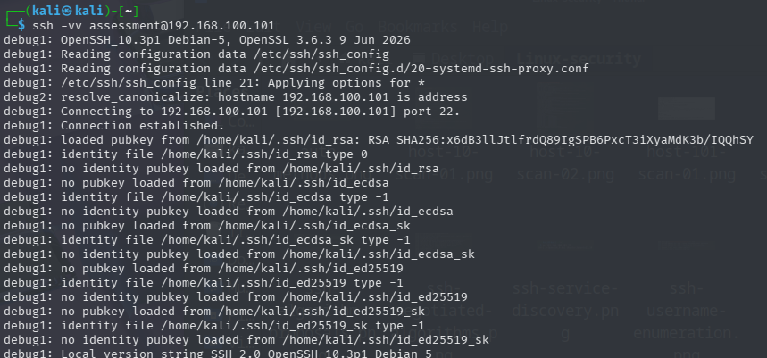
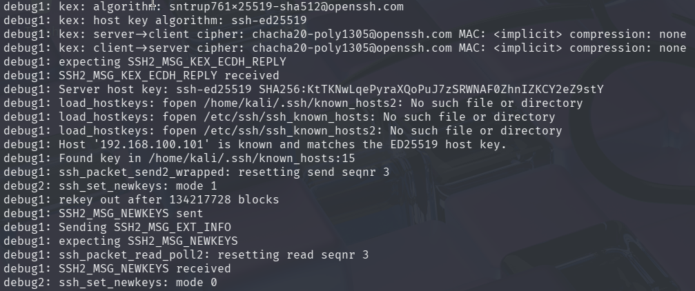

# SSH Service Assessment

## 1. Assessment Overview

### Objective

This assessment examines the remotely observable security characteristics of the SSH service identified during the reconnaissance phase.

The investigation focuses on:

- SSH service identification and version disclosure.
- SSH service fingerprinting using Metasploit.
- Advertised authentication methods.
- The reliability of remote username enumeration.
- Cryptographic algorithms supported by the SSH server.
- The algorithms selected during an actual SSH negotiation.

The objective is to collect and interpret evidence that can support an evaluation of the SSH service's security posture. An observed configuration characteristic is not automatically a vulnerability; potential weaknesses must be supported by evidence and evaluated in context.

### Scope

| Item | Value |
|---|---|
| Target | `192.168.100.101` |
| Service | SSH |
| Protocol | TCP |
| Port | `22` |
| Assessment perspective | Remote, unauthenticated |
| Assessment platform | Kali Linux |

Testing was conducted remotely from the assessment machine. Successful SSH authentication and authenticated access to the target were not established during this activity.

---

## 2. SSH Service Identification

### Objective

Identify the SSH service and determine whether it discloses implementation and version information through its initial protocol banner.

### Method

Netcat was used to connect to the SSH service:

```bash
nc 192.168.100.101 22
```

### Observed Result

The server returned the following banner:

```text
SSH-2.0-OpenSSH_9.6p1 Ubuntu-3ubuntu13.19
```

**Figure 1 — SSH service banner retrieved using Netcat**



### Analysis

The banner identifies the service as:

- SSH protocol version 2.0.
- OpenSSH version `9.6p1`.
- Ubuntu package revision `3ubuntu13.19`.

This provides an initial indication of the SSH implementation and its reported package version.

Version disclosure is useful during security assessment because it helps identify the software that should be evaluated against relevant security advisories and known vulnerabilities.

However, a banner alone does not establish that the service is vulnerable. Distribution maintainers may backport security fixes without changing the upstream version number in the way an assessor might expect. Any vulnerability assessment based on version information must account for the distribution's package history and security updates.

### Assessment Result

The SSH service was identified as OpenSSH `9.6p1` with the Ubuntu package revision `3ubuntu13.19`.

No vulnerability is established by the banner alone.

---

## 3. SSH Service Version and Cryptographic Fingerprinting

### Objective

Use an additional remote assessment tool to identify the SSH implementation, retrieve service fingerprinting information, and enumerate the cryptographic algorithms advertised by the server.

### Method

The Metasploit Framework SSH version scanner was used:

```text
auxiliary/scanner/ssh/ssh_version
```

The scanner was executed against `192.168.100.101`.

### Observed Result

The scanner reported:

- SSH server version: `SSH-2.0-OpenSSH_9.6p1 Ubuntu-3ubuntu13.19`.
- Service product: OpenSSH.
- Service version: `9.6p1`.
- Service protocol: SSH.
- Vendor identification: OpenBSD.
- Operating-system fingerprint information identifying Linux and Ubuntu.
- OS certainty reported as `0.75`.
- Host-key fingerprint information for Ed25519, RSA, and ECDSA.
- Supported encryption, MAC, host-key, key-exchange, and compression algorithms.

**Figure 2 — Metasploit SSH version scanner and service fingerprinting results**



### Analysis

The Metasploit scanner provides additional service identification and fingerprinting information beyond the initial banner retrieval.

The version reported by Metasploit agrees with the banner collected using Netcat:

`OpenSSH 9.6p1 Ubuntu-3ubuntu13.19`

This agreement corroborates the service identification across two assessment methods.

The scanner also identifies the service as OpenSSH and returns operating-system fingerprint information associated with Linux and Ubuntu. Its reported OS certainty of `0.75` should be understood as the scanner's fingerprinting assessment, not definitive proof of the target's operating system.

The scanner additionally retrieves host-key fingerprint information and enumerates supported cryptographic algorithms. These results provide an inventory for the subsequent cryptographic assessment.

One notable scanner annotation appears beside:

`ecdsa-sha2-nistp256`

The scanner labels this algorithm as a **weak elliptic curve**.

This is a tool-generated assessment annotation. It should be recorded and evaluated, but it must not automatically be classified as a confirmed vulnerability. The algorithm's security properties, implementation, operational requirements, and applicable cryptographic policy must be considered before assigning a finding.

The scanner also reports SHA-1-based HMAC options. Their presence is relevant to cryptographic policy review, but their advertisement does not establish that they were selected for the observed connection.

### Assessment Result

The Metasploit scanner corroborated the SSH implementation and version identified through the service banner and provided additional service fingerprinting and cryptographic inventory information.

The scanner's weak-elliptic-curve annotation and the presence of SHA-1-based HMAC options are recorded as items for further evaluation, not confirmed vulnerabilities.

---

## 4. SSH Authentication Method Enumeration

### Objective

Determine which SSH authentication methods the server advertises to a remote client.

### Method

Nmap's SSH authentication methods script was used:

```bash
nmap --script /usr/share/nmap/scripts/ssh-auth-methods.nse -p 22 192.168.100.101
```

### Observed Result

The server advertised the following authentication methods:

```text
publickey
password
```

**Figure 3 — SSH authentication methods reported by Nmap**



### Analysis

The two advertised methods are:

**Public-key authentication**

Public-key authentication uses a cryptographic key pair.

The client proves possession of a private key corresponding to a public key accepted by the server. The private key should remain under the control of its owner and should not be transmitted to the server.

**Password authentication**

Password authentication allows a client to submit an account password for verification by the server.

Its security depends on factors such as password strength, password reuse, account protection, rate limiting, and the server's authentication policy.

### Security Considerations

The availability of password authentication is not, by itself, proof of a vulnerability.

It introduces a password-based authentication path that should be evaluated in relation to the wider security controls protecting the service.

Similarly, the presence of public-key authentication does not establish that password authentication is disabled or that public-key authentication is enforced exclusively.

The enumeration result only identifies the methods advertised by the server. It does not establish:

- Whether a particular account exists.
- Whether supplied credentials are valid.
- Whether authentication succeeds.
- Whether the server enforces additional account-specific restrictions.

### Assessment Result

The SSH server advertises both `publickey` and `password` authentication.

This is a configuration observation for further consideration, not a confirmed vulnerability.

---

## 5. SSH Username Enumeration

### Objective

Determine whether the SSH service can be used to distinguish valid usernames from invalid usernames through differences in its remote responses.

### Method

The Metasploit Framework auxiliary module was used:

```text
auxiliary/scanner/ssh/ssh_enumusers
```

The module uses an SSH packet-handling technique to test whether response differences can reveal valid usernames.

### Observed Result

The module reported:

```text
[*] 192.168.100.101:22 - SSH - Using malformed packet technique
[*] 192.168.100.101:22 - SSH - Checking for false positives
[-] 192.168.100.101:22 - SSH - throws false positive results. Aborting.
[*] Scanned 1 of 1 hosts (100% complete)
[*] Auxiliary module execution completed
```

**Figure 4 — Metasploit SSH username enumeration attempt**



### Analysis

The module attempted username enumeration using a malformed-packet technique.

However, its false-positive validation stage determined that the responses could produce unreliable results. The module consequently aborted the enumeration attempt.

A username enumeration result is useful only when the observed response differences can reliably distinguish valid usernames from invalid usernames.

If the technique produces false positives, the returned usernames cannot be treated as verified account names.

### Assessment Result

Username enumeration was attempted but remained inconclusive.

No usernames were verified, and no username-disclosure vulnerability was established.

This result does not prove that the server is resistant to every possible username enumeration technique. It establishes only that this particular attempt did not produce reliable results.

---

## 6. SSH Cryptographic Algorithm Assessment

### Objective

Identify the cryptographic algorithms advertised by the SSH server and understand the options available during the SSH negotiation process.

### Method

The client initiated an SSH connection with verbose debugging enabled:

```bash
ssh -vv assessment@192.168.100.101
```

The verbose output exposes the client's algorithm proposals, the server's algorithm proposals, and the algorithms selected during negotiation.

The complete verbose output was preserved in:

```text
evidence/ssh-verbose-negotiation.txt
```

### Understanding the Algorithm Categories

SSH uses several cryptographic components to establish and protect a connection.

| Component | Purpose |
|---|---|
| Key exchange (KEX) | Establishes shared session secrets between the client and server. |
| Host-key algorithm | Allows the client to authenticate the server's host key during connection establishment. |
| Cipher | Encrypts data transmitted through the SSH connection. |
| Message authentication / integrity | Protects transmitted data against undetected modification. |
| Compression | Determines whether data is compressed before transmission. |

These components perform different functions and should not be treated as interchangeable.

### 6.1 Client and Server Algorithm Proposals

During the initial SSH negotiation, the client and server exchange their supported algorithm lists through their KEXINIT messages.

The verbose SSH output records both sides' proposals.

The client was identified as:

- OpenSSH `10.3p1` Debian-5.
- OpenSSL `3.6.3`.

The server's proposals included the following.

#### Key Exchange Algorithms

```text
sntrup761x25519-sha512@openssh.com
curve25519-sha256
curve25519-sha256@libssh.org
ecdh-sha2-nistp256
ecdh-sha2-nistp384
ecdh-sha2-nistp521
diffie-hellman-group-exchange-sha256
diffie-hellman-group16-sha512
diffie-hellman-group18-sha512
diffie-hellman-group14-sha256
```

#### Host Key Algorithms

```text
rsa-sha2-512
rsa-sha2-256
ecdsa-sha2-nistp256
ssh-ed25519
```

#### Encryption Algorithms (Ciphers)

```text
chacha20-poly1305@openssh.com
aes128-ctr
aes192-ctr
aes256-ctr
aes128-gcm@openssh.com
aes256-gcm@openssh.com
```

#### Message Authentication Algorithms (MACs)

```text
umac-64-etm@openssh.com
umac-128-etm@openssh.com
hmac-sha2-256-etm@openssh.com
hmac-sha2-512-etm@openssh.com
hmac-sha1-etm@openssh.com
umac-64@openssh.com
umac-128@openssh.com
hmac-sha2-256
hmac-sha2-512
hmac-sha1
```

#### Compression Algorithms

```text
none
zlib@openssh.com
```

The verbose KEXINIT output also identifies SSH protocol extension markers. These are protocol negotiation features rather than additional encryption algorithms.

**Figure 5 — Client and server cryptographic algorithm proposals**



### 6.2 Analysis of the Advertised Algorithms

The server's proposal list represents the algorithms it is willing to negotiate with a compatible client.

It is important to distinguish between an algorithm being advertised and an algorithm actually being selected.

The server can advertise several alternatives, but only compatible algorithms selected through the negotiation process are used for the connection.

**Key exchange**

The server advertises multiple key exchange methods, including:

```text
sntrup761x25519-sha512@openssh.com
curve25519-sha256
diffie-hellman-group14-sha256
```

The `sntrup761x25519-sha512@openssh.com` method combines the SNTRUP761 post-quantum-resistant component with X25519.

This is a hybrid approach: it combines a post-quantum-resistant component with a conventional elliptic-curve component.

**Host-key algorithms**

The server advertises RSA SHA-2, ECDSA, and Ed25519 host-key algorithms.

These algorithms are used for server host-key authentication during connection establishment. They are separate from the algorithms used to encrypt the actual session traffic.

The Metasploit scanner's annotation concerning `ecdsa-sha2-nistp256` is retained as a point for cryptographic review. Its presence in the proposal list does not establish that it was selected or that the server is exploitable.

**Ciphers**

The advertised ciphers include ChaCha20-Poly1305, AES in CTR mode, and AES in GCM mode.

ChaCha20-Poly1305 and AES-GCM are authenticated-encryption constructions. They provide confidentiality and integrity protection together.

AES-CTR provides encryption but requires a separate integrity mechanism, such as a suitable MAC.

**Message authentication algorithms**

The server also advertises several MAC algorithms, including SHA-2-based HMACs, UMAC variants, and SHA-1-based HMACs.

The presence of SHA-1-based HMAC options deserves attention when reviewing cryptographic policy.

However, their advertisement does not establish that they were used during the observed connection or that the service is exploitable. Their acceptability should be evaluated against the applicable cryptographic standards and compatibility requirements.

**Compression**

The server advertises `none` and `zlib@openssh.com`.

The `none` option means that compression is not applied to the SSH session.

### Assessment Result

The server advertises multiple key exchange, host-key, cipher, MAC, and compression options.

The presence of legacy or less-preferred alternatives should be considered during cryptographic policy review. Their presence alone is not sufficient to classify the service as vulnerable.

The actual negotiation must be examined separately to determine which algorithms were selected for the observed connection.

---

## 7. Actual SSH Algorithm Negotiation

### Objective

Determine which cryptographic algorithms were selected when the client established an SSH connection with the server.

The proposal lists show what each side supports. The negotiated results show which compatible options were selected for this connection.

### Method

The connection was initiated with verbose debugging enabled:

```bash
ssh -vv assessment@192.168.100.101
```

The username `assessment` was supplied as part of the connection request. Its use in this command does not establish that an account with that name exists on the target.

The initial connection and client-side context are visible in the verbose SSH screenshot.

**Figure 6 — Verbose SSH connection initiation and client-side information**



### 7.1 Observed Negotiation Results

The verbose output reported:

```text
debug1: kex: algorithm: sntrup761x25519-sha512@openssh.com
debug1: kex: host key algorithm: ssh-ed25519
debug1: kex: server->client cipher: chacha20-poly1305@openssh.com MAC: <implicit> compression: none
debug1: kex: client->server cipher: chacha20-poly1305@openssh.com MAC: <implicit> compression: none
```

**Figure 7 — Algorithms selected during SSH negotiation**



### 7.2 Negotiated Algorithm Breakdown

| Component | Selected algorithm | Purpose |
|---|---|---|
| Key exchange | `sntrup761x25519-sha512@openssh.com` | Establishes shared session secrets. |
| Host key | `ssh-ed25519` | Authenticates the server's host key. |
| Server to client cipher | `chacha20-poly1305@openssh.com` | Protects traffic sent by the server. |
| Client to server cipher | `chacha20-poly1305@openssh.com` | Protects traffic sent by the client. |
| MAC | Implicit | Integrity is provided by the authenticated-encryption cipher. |
| Compression | `none` | No compression is applied. |

### 7.3 Interpretation of the Negotiated Results

**Key exchange: `sntrup761x25519-sha512@openssh.com`**

The client and server selected the hybrid SNTRUP761 and X25519 key exchange method.

SSH negotiation selects a mutually supported algorithm according to the protocol's ordering and selection rules. The fact that an algorithm appears in a proposal list does not mean that it must be selected.

The selected method establishes the shared secrets used to derive the session's cryptographic keys.

**Host key: `ssh-ed25519`**

The server selected Ed25519 for host-key authentication.

The host key helps the client verify that it is communicating with a server presenting the expected host identity.

The verbose output also reported:

```text
debug1: Server host key: ssh-ed25519 SHA256:KtTKNwLqePyraXQoPuJ7zSRWNAF0ZhnIZKCY2eZ9stY
debug1: Host '192.168.100.101' is known and matches the ED25519 host key.
debug1: Found key in /home/kali/.ssh/known_hosts:15
```

This indicates that the presented host key matched the key already recorded in the Kali machine's `known_hosts` file.

It demonstrates consistency with the previously recorded key on that machine. It is not, by itself, independent proof of the target's identity or proof that the original key was obtained through a trusted channel.

**Cipher: `chacha20-poly1305@openssh.com`**

The same cipher was selected for both directions:

- Server to client.
- Client to server.

ChaCha20-Poly1305 is an authenticated-encryption construction.

It provides confidentiality by encrypting transmitted data and integrity protection by authenticating the encrypted data.

**MAC: `<implicit>`**

The output reports:

```text
MAC: <implicit>
```

This does not mean that the connection has no integrity protection.

With an authenticated-encryption cipher such as ChaCha20-Poly1305, the authentication tag is integrated into the cipher construction. A separate MAC algorithm is therefore not required.

This explains why the output identifies the MAC as implicit rather than naming a separate HMAC or UMAC algorithm.

**Compression: `none`**

The connection negotiated no compression.

Consequently, the SSH session does not apply the advertised `zlib@openssh.com` compression option.

### 7.4 Completion of Key Exchange

The verbose output also reported:

```text
debug1: SSH2_MSG_NEWKEYS sent
debug1: SSH2_MSG_NEWKEYS received
```

These messages indicate that both sides exchanged the protocol messages that activate the newly established session keys.

This is evidence that the SSH key exchange progressed to the point where the negotiated cryptographic protection was activated.

It does not establish successful user authentication.

### 7.5 Negotiation Versus Authentication

SSH connection establishment involves several stages.

The client and server first negotiate protocol parameters and establish cryptographic protection. User authentication takes place after this connection-establishment process.

Therefore, the successful exchange of `NEWKEYS` messages does not mean that the supplied username or password was accepted.

The evidence establishes that the cryptographic negotiation completed. It does not establish authenticated access to the target.

### Assessment Result

The observed connection selected:

- Hybrid SNTRUP761/X25519 key exchange.
- Ed25519 host-key algorithm.
- ChaCha20-Poly1305 encryption in both directions.
- Integrated integrity protection through the authenticated-encryption cipher.
- No compression.

The observed negotiation used modern cryptographic options.

This is a positive observation about the specific connection tested. It does not prove that every algorithm advertised by the server is appropriate or that the entire SSH service is secure.

The complete verbose output is preserved in `evidence/ssh-verbose-negotiation.txt`.

---

## 8. Consolidated Assessment Observations

The following table summarises the evidence collected during the SSH investigation.

| Assessment area | Observation | Assessment |
|---|---|---|
| Service identification | OpenSSH `9.6p1 Ubuntu-3ubuntu13.19` | Identified |
| Metasploit version scan | Corroborated service version and returned fingerprint information | Corroborated |
| Authentication methods | `publickey` and `password` advertised | Configuration observation |
| Username enumeration | Metasploit validation detected false-positive results and aborted | Inconclusive |
| Key exchange proposals | Multiple algorithms advertised, including hybrid SNTRUP761/X25519 | Identified |
| Host-key proposals | RSA SHA-2, ECDSA, and Ed25519 advertised | Identified |
| Cipher proposals | ChaCha20-Poly1305 and AES variants advertised | Identified |
| MAC proposals | SHA-2, UMAC, and SHA-1-based HMAC options advertised | Cryptographic policy consideration |
| Metasploit algorithm annotation | ECDSA P-256 labelled as a weak elliptic curve | Requires evaluation |
| Actual key exchange | `sntrup761x25519-sha512@openssh.com` | Negotiated |
| Actual host key | `ssh-ed25519` | Negotiated |
| Actual cipher | `chacha20-poly1305@openssh.com` in both directions | Negotiated |
| Actual integrity protection | Integrated into the authenticated-encryption cipher | Negotiated |
| Actual compression | `none` | Negotiated |

### Overall Interpretation

The investigation successfully identified the SSH implementation, corroborated its version through a second assessment tool, enumerated its advertised authentication methods, examined its cryptographic proposals, and observed the algorithms selected during an actual SSH negotiation.

The username enumeration attempt did not produce reliable results because the module's false-positive validation failed.

The observed connection negotiated a hybrid key exchange method, Ed25519 host-key authentication, and ChaCha20-Poly1305 authenticated encryption.

The server also advertises SHA-1-based HMAC options and an ECDSA P-256 host-key option that the Metasploit scanner annotated as a weak elliptic curve. These observations warrant consideration during a cryptographic policy review, but neither establishes a confirmed vulnerability.

**No confirmed SSH vulnerability was established by the evidence collected in this assessment.**

---

## 9. Assessment Limitations

The conclusions in this document are limited to the tests performed and the evidence collected.

The following limitations apply:

1. **Unauthenticated assessment:** The investigation was conducted remotely without establishing successful user authentication.

2. **No verified account names:** The username enumeration attempt was inconclusive. No usernames were confirmed.

3. **No credential testing:** No password brute-force or credential-stuffing activity was performed.

4. **No authenticated testing:** The investigation did not establish access to the target's shell, files, or internal resources through SSH.

5. **No post-authentication assessment:** Privilege escalation, local permissions, and post-login security controls were not examined through an authenticated SSH session.

6. **Algorithm negotiation scope:** The negotiated algorithms represent one observed client-server connection. Different clients or configurations may negotiate different combinations.

7. **Version identification limitation:** The reported OpenSSH banner identifies the implementation and package revision but does not independently establish vulnerability status.

8. **Username enumeration limitation:** The Metasploit module aborted after detecting false-positive results. The result cannot be used to conclude that all username enumeration techniques are ineffective.

9. **Host-key verification limitation:** The observed host key matched the existing Kali `known_hosts` entry. This establishes consistency with the locally recorded key, not independent verification of the server's identity.

10. **Scanner annotation limitation:** The Metasploit scanner's weak-elliptic-curve label is a tool-generated observation. It requires independent evaluation before any security finding can be assigned.

11. **Configuration visibility:** The assessment relied on remotely observable behaviour. Server-side configuration settings were not treated as black-box evidence in this report.

These limitations must be considered before drawing broader conclusions about the security of the SSH service.

---

## 10. Conclusion

The SSH assessment examined the remotely observable characteristics of the service running on `192.168.100.101`.

The investigation identified the OpenSSH implementation, corroborated its version using Metasploit, determined that the server advertises public-key and password authentication, attempted username enumeration, examined the server's cryptographic algorithm proposals, and observed an actual SSH algorithm negotiation.

The observed connection successfully negotiated a hybrid SNTRUP761/X25519 key exchange, Ed25519 host-key authentication, and ChaCha20-Poly1305 authenticated encryption in both directions.

The server's advertised SHA-1-based HMAC options and the scanner's annotation concerning ECDSA P-256 represent points for cryptographic policy consideration. However, the observed connection did not negotiate a separate SHA-1-based MAC or the ECDSA host-key algorithm.

The username enumeration attempt was inconclusive because the module detected unreliable false-positive results and aborted.

Based on the evidence collected, no confirmed SSH vulnerability has been established. This conclusion is restricted to the remote tests performed and does not constitute a declaration that the SSH service or the underlying server is entirely secure.

The SSH investigation therefore concludes with documented observations and limitations. Any potential findings must be evaluated further before remediation decisions are made.
